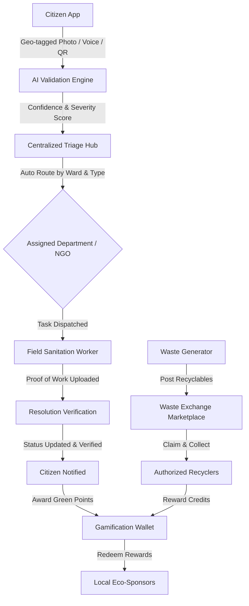

# SwachhMitra ♻️
### AI-Powered Clean & Green CivicTech Platform

[](https://react.dev/)
[](https://www.typescriptlang.org/)
[](https://vitejs.dev/)
[](https://tailwindcss.com/)
[](https://supabase.com/)
[](LICENSE)

SwachhMitra is a next-generation civic technology platform engineered to transform municipal sanitation, solid waste segregation, and civic accountability into an intelligent, community-driven ecosystem. By combining **AI-assisted issue validation**, **geospatial intelligence**, **circular economy incentives**, and **transparent civic workflows**, SwachhMitra empowers citizens and municipal authorities to collaborate seamlessly for cleaner and greener cities.

---

## 📌 Table of Contents

- [Problem Statement](#-problem-statement)
- [System Architecture & Workflow](#-system-architecture--workflow)
- [Key Features](#-key-features)
  - [1. Citizen Experience & Smart Reporting](#1-citizen-experience--smart-reporting)
  - [2. Administrative Command & Dispatch Center](#2-administrative-command--dispatch-center)
  - [3. Circular Economy & Waste Exchange Marketplace](#3-circular-economy--waste-exchange-marketplace)
  - [4. Community Collaboration & Gamification](#4-community-collaboration--gamification)
  - [5. Analytics & Urban Intelligence](#5-analytics--urban-intelligence)
  - [6. Eco-Sponsorships & Partner Rewards](#6-eco-sponsorships--partner-rewards)
- [Technology Stack](#-technology-stack)
- [Repository Structure](#-repository-structure)
- [Getting Started](#-getting-started)
  - [Prerequisites](#prerequisites)
  - [Installation](#installation)
  - [Environment Configuration](#environment-configuration)
  - [Running the Application](#running-the-application)
- [Demo Credentials](#-demo-credentials)
- [Key Design Decisions](#-key-design-decisions)
- [Future Roadmap](#-future-roadmap)
- [Contributing](#-contributing)
- [License](#-license)

---

## 🚨 Problem Statement

Urban municipal sanitation systems often encounter critical operational bottlenecks:

- **Grievance Latency:** Delays in identifying, assigning, and resolving neighborhood sanitation complaints.
- **Source Segregation Deficits:** Ineffective separation of biodegradable, recyclable, and hazardous municipal waste.
- **Accountability Gaps:** Limited transparency in municipal triage, worker assignment, and verified proof-of-work.
- **Low Public Engagement:** Lack of positive reinforcement or incentives for citizens participating in civic hygiene.
- **Data Blindspots:** Absence of real-time geospatial sanitation heatmaps to proactively prevent vector-borne disease outbreaks.

**SwachhMitra** bridges this gap through an end-to-end digital pipeline uniting citizens, sanitation departments, non-governmental organizations, and commercial recyclers.

---

## 🔄 System Architecture & Workflow

The platform handles the entire lifecycle of civic grievances—from capture to verifiable resolution:



A high-resolution workflow diagram is also provided in the repository:
📁 **[`system-workflow.png`](./system-workflow.png)**

---

## ✨ Key Features

### 1. Citizen Experience & Smart Reporting
- **In-App Camera Capture:** Instant visual evidence acquisition directly via browser hardware integration (`navigator.mediaDevices`).
- **One-Tap Geolocation:** Automatic coordinates capture (`GPS Latitude & Longitude`) via the Geolocation API with manual fallback.
- **Voice-to-Text Reporting:** Voice memo support to streamline reporting for citizens across literacy levels.
- **QR-Code Bin Scanning:** Rapid issue logging for tagged public dustbins, sanitation kiosks, and smart dumpsters.
- **Automated AI Triage:** Real-time analysis assessing image validity, priority levels (`Low`, `Medium`, `High`), and categorization (Garbage Overflow, Clogged Drains, Stagnant Water, Broken Toilets, etc.).
- **Live Ticket Tracker:** Real-time status indicators tracking reports across `Reported`, `Verified`, `In Progress`, and `Resolved`.

### 2. Administrative Command & Dispatch Center
- **Unified Grievance Feed:** Comprehensive dashboard for civic administrators to triage, filter, and prioritize reports.
- **Department & NGO Routing:** Automated and manual delegation to specialized municipal cells (Sanitation, Drainage, Public Health, Environmental NGOs).
- **Field Personnel Dispatch:** Worker assignment, SLA monitoring, and performance scorecards.
- **Tamper-Evident Audit Trails:** Activity tracking logging timestamps, dispatchers, and resolution proofs for full municipal accountability.
- **Disease Hazard Alerts:** Vector-borne disease surveillance flags for persistent stagnant water and uncollected refuse.

### 3. Circular Economy & Waste Exchange Marketplace
- **Direct Recycler Marketplace:** Connects households and businesses directly with certified local recyclers.
- **Category-Based Waste Listings:** Segregation support for Plastic, Paper & Cardboard, Metal Scrap, Organic Waste, and E-Waste.
- **Weight & Quantity Pricing:** Transparent metric-based listings with clear valuation and pickup coordination.
- **Landfill Diversion Impact:** Tracks total kilograms diverted from municipal dumpsites.

### 4. Community Collaboration & Gamification
- **Hyperlocal Issue Feed:** Citizens can view and upvote nearby reported issues to heighten urgency.
- **Green Points Engine:** Earn reward points for verified issue reports, clean-up drives, and recyclable waste contributions.
- **Cleanliness Leaderboards:** Ward-level and city-wide rankings recognizing civic champions.
- **Community Drives:** Organize, schedule, and join localized volunteer sanitation drives.

### 5. Analytics & Urban Intelligence
- **Ward-Level Performance Indicators:** Comparative metrics illustrating response time, clearance percentage, and backlog volume.
- **Geographic Hotspots:** Visual identification of chronic garbage dump zones and drainage failure clusters.
- **Trend Forecasts:** Predictive analytics identifying seasonal spikes in waste generation and sanitation demands.

### 6. Eco-Sponsorships & Partner Rewards
- **Merchant Ecosystem:** Local sustainable businesses, cafes, and zero-waste stores list exclusive redemption coupons.
- **Voucher Wallet:** Seamless point redemption encouraging sustainable consumption habits within the community.

---

## 🛠 Technology Stack

| Layer | Technologies |
| :--- | :--- |
| **Frontend Framework** | [React 18](https://react.dev/) + [TypeScript](https://www.typescriptlang.org/) |
| **Build Tool & Bundler** | [Vite 7](https://vitejs.dev/) |
| **Styling & Design System** | [Tailwind CSS 3](https://tailwindcss.com/) + PostCSS + Autoprefixer |
| **Icons & Visual Language** | [Lucide React](https://lucide.dev/) |
| **Routing** | [React Router DOM v7](https://reactrouter.com/) |
| **Backend & Persistence** | [Supabase](https://supabase.com/) (Auth, Database, Storage) + Built-in Mock Provider |
| **State Management** | React Context API (`AuthContext`) |
| **Hardware APIs** | Browser Geolocation API, HTML5 MediaDevices / Camera Stream |

---

## 📂 Repository Structure

```text
├── .bolt/                  # Template configuration and developer instructions
├── public/                 # Static assets and icons
├── src/
│   ├── components/         # Reusable UI elements (Navigation Header, Modals, etc.)
│   │   └── Header.tsx
│   ├── contexts/           # Global application states
│   │   └── AuthContext.tsx # Authentication, session state, and Green Points wallet
│   ├── lib/                # Utility configurations and mock database stores
│   │   └── supabase.ts     # Supabase client instantiation and development fixtures
│   ├── pages/              # Application route views
│   │   ├── AdminDashboard.tsx   # Municipal administrative control hub
│   │   ├── Analytics.tsx        # Civic insights, ward stats, and charts
│   │   ├── Community.tsx        # Social forum, upvotes, and clean-up drives
│   │   ├── IssueReporting.tsx   # Grievance filing with camera & geolocation
│   │   ├── LandingPage.tsx      # Platform overview, hero section, and features
│   │   ├── Login.tsx            # Citizen & Admin authentication portal
│   │   ├── Profile.tsx          # User profile, badges, and activity history
│   │   ├── Sponsorships.tsx     # Local sponsor discount store
│   │   ├── UserDashboard.tsx    # Citizen control panel and live ticket tracking
│   │   └── WasteExchange.tsx    # Circular economy peer-to-recycler portal
│   ├── App.tsx             # Root router configuration and layout wrapper
│   ├── index.css           # Global Tailwind CSS definitions
│   ├── main.tsx            # Application bootstrapping
│   └── vite-env.d.ts       # Vite TypeScript type declarations
├── eslint.config.js        # Code quality and linting configuration
├── index.html              # HTML5 application shell
├── package.json            # Project dependencies and script declarations
├── postcss.config.js       # PostCSS plugins
├── system-workflow.png     # Visual system architecture flowchart
├── tailwind.config.js      # Tailwind CSS configuration and theme tokens
├── tsconfig.json           # Root TypeScript configuration
├── tsconfig.app.json       # Application TypeScript rules
├── tsconfig.node.json      # Node-specific TypeScript rules
└── vercel.json             # Deployment routing configuration
```

---

## 🚀 Getting Started

### Prerequisites

Ensure you have the following installed on your development machine:
- **Node.js**: `v18.0.0` or higher
- **npm**: `v9.0.0` or higher (or `pnpm` / `yarn`)
- **Git**

### Installation

1. **Clone the repository:**
   ```bash
   git clone https://github.com/rishavraj-dev/SwachhMitra-SwatchBharatproject.git
   cd SwachhMitra-SwatchBharatproject
   ```

2. **Install project dependencies:**
   ```bash
   npm install
   ```

### Environment Configuration

The application includes an integrated local development fallback mode with realistic mock datasets, enabling immediate testing without third-party services.

To connect an active Supabase backend, create a `.env` file in the root directory:

```bash
# Create environment file
cp .env.example .env
```

Add your Supabase credentials:

```env
VITE_SUPABASE_URL=https://your-project-id.supabase.co
VITE_SUPABASE_ANON_KEY=your-anon-public-key
```

### Running the Application

- **Start Development Server:**
  ```bash
  npm run dev
  ```
  The application will be live at `http://localhost:5173`.

- **Type Check Code:**
  ```bash
  npm run typecheck
  ```

- **Lint Codebase:**
  ```bash
  npm run lint
  ```

- **Build for Production:**
  ```bash
  npm run build
  ```

- **Preview Production Build:**
  ```bash
  npm run preview
  ```

---

## 🔑 Demo Credentials

For quick evaluation and review, the platform comes pre-configured with instant demo authentication accessible directly from the **[Login Portal](/login)**:

| Role | Email | Password | Access Level |
| :--- | :--- | :--- | :--- |
| **Citizen (Default)** | `user@example.com` | `password` | Citizen Dashboard, Issue Reporting, Waste Exchange, Community Feed, Profile |
| **Administrator** | `admin@example.com` | `password` | Municipal Command Center, Ticket Triage, Department Routing, Field Assignment |

> **Tip:** You can click the **"Demo as User"** or **"Demo as Admin"** buttons on the sign-in screen to instantly authenticate without manual typing.

---

## 💡 Key Design Decisions

1. **Offline & Low-Bandwidth Considerations:** Lightweight assets and responsive layouts ensure usability across mobile devices in diverse field conditions.
2. **Modular Architecture:** Clear separation between presentation components, state providers, and mock data providers makes migrating from development mode to full microservices seamless.
3. **Inclusive Civic Access:** Support for multi-modal issue filing (photo capture, quick forms, voice descriptions, QR tags) ensures all demographic groups can report problems effortlessly.
4. **Circular Economy Integration:** Unlike standard complaint portals, integrating the Waste Exchange creates a positive financial incentive loop for citizens to segregate waste before it reaches streets or landfills.

---

## 🔮 Future Roadmap

- [ ] Native Mobile App builds (React Native / PWA offline service workers)
- [ ] Computer Vision model integration on edge for real-time trash classification (biodegradable vs. non-biodegradable)
- [ ] Automated drone and vehicle-mounted camera survey integrations for automated litter detection
- [ ] Municipal ERP and GIS integration (smart city API conduits)
- [ ] Multi-regional multilingual audio localization

---

## 🤝 Contributing

Contributions to enhance urban civic hygiene and smart waste solutions are welcome!

1. Fork the Project
2. Create your Feature Branch (`git checkout -b feature/AmazingFeature`)
3. Commit your Changes (`git commit -m 'Add some AmazingFeature'`)
4. Push to the Branch (`git push origin feature/AmazingFeature`)
5. Open a Pull Request

---

## 📄 License

This project is open-source and distributed under the [MIT License](LICENSE).
